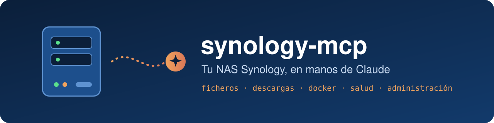

[English](README.md) · **Español**

<p align="center">
  
</p>

<p align="center">
  <a href="https://github.com/r03eRt/synology-mcp/actions/workflows/ci.yml"></a>
  <a href="https://github.com/r03eRt/synology-mcp/releases"></a>
  <a href="LICENSE"></a>
  
  
  
</p>

<p align="center">
  <b>Habla con tu NAS.</b> Busca ficheros, gestiona descargas y contenedores, vigila los discos y administra DSM<br>
  desde <b>Claude Code</b> o <b>Claude Desktop</b>, en casa o fuera con QuickConnect. Seguro por defecto.
</p>

<p align="center">
  <a href="#instalación-rápida">Instalación rápida</a> ·
  <a href="#6-herramientas">84 herramientas</a> ·
  <a href="#5-seguridad">Seguridad</a> ·
  <a href="#7-ejemplos-de-peticiones">Ejemplos</a> ·
  <a href="docs/README.md">Documentación</a>
</p>

---

## Así se usa

> **Tú:** ¿Cómo está el NAS?
>
> **Claude:** Todo funciona, pero hay tres cosas que mirar:
> - 🌡️ **41 °C**, encendido 23 días. El volumen está al **89 %**.
> - 💽 El Disco 1 tiene 8 sectores reasignados, **estables** en las 12 últimas comprobaciones; los dos discos llevan casi 7 años en marcha.
> - 🔒 Hay una **actualización de seguridad** de DSM y dos paquetes con versión nueva.
>
> **Tú:** Libera espacio.
>
> **Claude:** Hay **6,7 GB** en papeleras (casi todo en Descargas) e imágenes de Docker que no usa ningún contenedor, como la versión anterior de Immich (1,6 GB). ¿Vacío la papelera de Descargas y borro esas imágenes?

Cada respuesta sale de las herramientas de este servidor sobre tu NAS real. Las acciones que borran o cambian algo **siempre piden confirmación**.

## Qué puede hacer

| | Área | Lo más útil |
|---|---|---|
| 📁 | **Ficheros** | Buscar por nombre, tipo, tamaño o fecha · leer documentos e imágenes · subir y descargar · mover, comprimir · compartir con enlace |
| ☁️ | **Synology Drive** | Recientes, estrellas, etiquetas, compartidos · convertir a Synology Office |
| ⬇️ | **Descargas** | Buscar torrents · URLs, magnets y `.torrent` · elegir ficheros · RSS · límites de velocidad y horario · detectar descargas muertas |
| 🐳 | **Docker** | Estado, CPU/RAM y registros de contenedores · arrancar, parar y reiniciar · limpiar imágenes |
| 🩺 | **Salud** | SMART de cada disco · actualizaciones pendientes · notificaciones y registros · volúmenes |
| 🧹 | **Espacio** | Papeleras, imágenes sin usar y carpetas que más ocupan |
| 🛠️ | **Administración** | Usuarios (crear, desactivar, borrar), grupos, permisos de carpetas, tareas programadas · avisos de servicios inseguros (SMB1, FTP…) |
| 🌍 | **En cualquier sitio** | QuickConnect (red local, directa o relé de Synology) · varios NAS |

## Instalación rápida

```bash
claude plugin marketplace add r03eRt/synology-mcp
claude plugin install synology@synology-mcp
```

Después, en Claude Code: `/plugin configure synology@synology-mcp`. Pon la dirección del NAS (`http://192.168.1.10:5000` o `quickconnect:<tu ID>`), el usuario y la contraseña, y pregúntale lo que quieras.

¿Usas Claude Desktop? Descarga el `.mcpb` de [Releases](https://github.com/r03eRt/synology-mcp/releases) y ábrelo. Más opciones en [Instala](#3-instala).

> Proyecto independiente, sin relación con Synology Inc. Licencia MIT. Probado en un DS218+ con DSM 7.4.1.

## Índice

1. [Requisitos](#1-requisitos)
2. [Prepara un usuario en DSM](#2-prepara-un-usuario-en-dsm)
3. [Instala](#3-instala)
4. [Configuración](#4-configuración)
5. [Seguridad](#5-seguridad)
6. [Herramientas](#6-herramientas)
7. [Ejemplos de peticiones](#7-ejemplos-de-peticiones)
8. [Problemas frecuentes](#8-problemas-frecuentes)
9. [Actualizar](#9-actualizar)
10. [Desarrollo](#10-desarrollo)
11. [Limitaciones y próximos pasos](#11-limitaciones-y-próximos-pasos)

## 1. Requisitos

- Un NAS Synology con **DSM 7** (7.2 o superior recomendado), accesible desde el ordenador donde corre Claude:
  - por su IP o nombre, en la misma red, por VPN o con un puerto abierto;
  - o por **QuickConnect** (`quickconnect:<tu ID>`), que funciona desde cualquier sitio sin abrir puertos.
- **Node.js 22.19 o superior** en ese ordenador, para Claude Code o la instalación manual. Claude Desktop trae su propio Node.
- Para cada área, su paquete instalado en el NAS: Synology Drive Server, Download Station o Container Manager. Las herramientas de un paquete que no esté instalado responden "is … installed?". `get_system_info` dice qué paquetes hay.

## 2. Prepara un usuario en DSM

Claude solo puede hacer lo que permita el usuario de DSM que configures; esa es la principal barrera de seguridad.

**Recomendado: un usuario específico, sin permisos de administrador.**

1. En *Panel de control → Usuario y grupo*, crea un usuario, por ejemplo `claude`.
2. En *Permisos*, dale lectura (o lectura y escritura) **solo** en las carpetas compartidas que quieras que Claude vea.
3. En *Aplicaciones*, permítele File Station y, si los usas, Synology Drive y Download Station.

Qué funciona con cada tipo de cuenta:

| Con un usuario normal | Solo con un administrador |
|---|---|
| Ficheros, Drive, Download Station (sus propias descargas), `get_system_info` | Docker, salud del NAS (`get_system_utilization`, `get_storage_status`, `get_disk_health`, `check_updates`, `get_notifications`, `get_system_logs`), papeleras, administración (`dsm_*`) y las descargas de todos los usuarios |

Usar un administrador da a Claude acceso a todo el NAS. Si lo haces, considera dejar el modo solo lectura activado.

**Si tu cuenta tiene verificación en dos pasos (2FA)**, registra Claude una vez como dispositivo de confianza. Te pedirá el código del autenticador:

```bash
SYNOLOGY_URL=http://192.168.1.10:5000 SYNOLOGY_USERNAME=claude SYNOLOGY_PASSWORD='…' npx synology-mcp register-device
```

Imprime `SYNOLOGY_DEVICE_ID=…`: ponlo en la configuración (campo «2FA device token»). El dispositivo aparece en DSM (*Personal → Seguridad*) y se puede revocar allí.

## 3. Instala

### Claude Code: plugin (recomendado)

```bash
claude plugin marketplace add r03eRt/synology-mcp
```

```bash
claude plugin install synology@synology-mcp
```

Después, dentro de Claude Code, rellena los datos con `/plugin configure synology@synology-mcp`. La contraseña se guarda en el almacén de credenciales del sistema. El plugin trae:

- el servidor ya empaquetado, sin dependencias que instalar;
- la skill `synology-nas`, que enseña a Claude a usar bien el NAS: rutas, qué herramienta usar para cada cosa, confirmar antes de borrar o de parar servicios, y cómo interpretar la salud de los discos.

### Claude Desktop: extensión

Descarga `synology-mcp-<versión>.mcpb` de [Releases](https://github.com/r03eRt/synology-mcp/releases) y ábrelo con doble clic. Claude Desktop pide los mismos datos y guarda la contraseña en el llavero.

### Instalación manual (cualquier cliente MCP)

> El paquete npm todavía **no está publicado**: `npx synology-mcp` no funcionará hasta entonces. Mientras tanto, usa el código.

```bash
git clone https://github.com/r03eRt/synology-mcp.git
```

```bash
cd synology-mcp && npm install && npm run build
```

Configuración del cliente MCP:

```json
{
  "mcpServers": {
    "synology": {
      "command": "node",
      "args": ["/ruta/a/synology-mcp/dist/index.js"],
      "env": {
        "SYNOLOGY_URL": "http://192.168.1.10:5000",
        "SYNOLOGY_USERNAME": "claude",
        "SYNOLOGY_PASSWORD": "…"
      }
    }
  }
}
```

Para no dejar la contraseña en la configuración del cliente, guárdala en un fichero `.env` con permisos `600` y arranca con `node --env-file=/ruta/.env /ruta/a/synology-mcp/dist/index.js`. En Claude Code:

```bash
claude mcp add synology -s user -- node --env-file=/ruta/.env /ruta/a/synology-mcp/dist/index.js
```

## 4. Configuración

| Variable | Campo del plugin / extensión | Por defecto | Para qué |
|---|---|---|---|
| `SYNOLOGY_URL` | NAS URL | — | Dirección de DSM con puerto (`http://IP:5000`, `https://nombre:5001`) o `quickconnect:<ID>` |
| `SYNOLOGY_USERNAME` | DSM user | — | Usuario de DSM |
| `SYNOLOGY_PASSWORD` | DSM password | — | Contraseña |
| `SYNOLOGY_READ_ONLY` | Read-only | `true` | `false` activa las 32 herramientas de escritura (crear, mover, borrar, descargar, parar contenedores, cambiar permisos…) |
| `SYNOLOGY_INSECURE_TLS` | Accept an invalid HTTPS certificate | `false` | Acepta un certificado HTTPS autofirmado, caducado o de otro nombre. Solo en una red de confianza |
| `SYNOLOGY_DEVICE_ID` | 2FA device token | — | Token de `register-device`, para cuentas con 2FA |
| `SYNOLOGY_DEVICE_NAME` | — | `synology-mcp` | Nombre con el que se registró el dispositivo |
| `SYNOLOGY_TASK_TIMEOUT_MS` | — | `60000` | Cuánto espera una herramienta a una operación larga (copiar, borrar, buscar…) antes de devolver su `taskid` para consultarla luego |
| `SYNOLOGY_NAS_FILE` | — | — | Fichero JSON con **varios NAS** (ver abajo). Sustituye a las tres primeras variables |

### Usarlo fuera de casa: QuickConnect

Pon `SYNOLOGY_URL=quickconnect:<ID>`, con el ID que ves en DSM en *Panel de control → Acceso externo → QuickConnect*, que debe estar activado. Al conectar, el MCP pregunta al servicio de Synology dónde está el NAS y prueba, por este orden:

1. **Red local**: un nombre `…direct.quickconnect.to` que apunta a la IP local del NAS.
2. **Conexión directa por Internet**, solo si el NAS es accesible desde fuera.
3. **El relé de Synology**: funciona desde cualquier sitio sin abrir puertos, aunque es más lento.

Usa la primera que responde. Las tres tienen certificado válido, así que no hace falta `SYNOLOGY_INSECURE_TLS`. Si la conexión se corta (por ejemplo, al salir de casa), vuelve a buscar la mejor vía en la siguiente llamada. El ID se envía al servicio de Synology, igual que hacen sus propias aplicaciones.

### Varios NAS

Con `SYNOLOGY_NAS_FILE=/ruta/nas.json` (permisos `600`):

```json
{
  "default": "casa",
  "nas": [
    { "name": "casa", "url": "http://192.168.1.2:5000", "username": "claude", "password_env": "NAS_CASA_PASSWORD" },
    { "name": "padres", "url": "quickconnect:nas-padres", "username": "claude", "password_env": "NAS_PADRES_PASSWORD" }
  ]
}
```

- **Contraseña**: `password_env` es el nombre de una variable de entorno que la contiene; así no queda en el fichero. También se admite `password` directamente.
- **Otros campos opcionales por NAS**: `device_id` / `device_id_env` (2FA), `device_name` e `insecure_tls`.
- **Globales**: `SYNOLOGY_READ_ONLY` y `SYNOLOGY_TASK_TIMEOUT_MS` valen para todos.
- **Herramientas**: aparecen `list_nas` (qué NAS hay, cuál está activo y por dónde se llega a cada uno) y `use_nas` (cambiar de NAS); el resto actúa sobre el activo. Pídele a Claude «cambia al NAS de mis padres».
- **2FA**: `register-device --nas <nombre>` registra el dispositivo en uno concreto.
- **Dónde funciona**: de momento solo en la instalación manual; el plugin y la extensión configuran un NAS.

Detalles, y cómo está registrado en el equipo del autor, en [docs/configuracion.md](docs/configuracion.md).

## 5. Seguridad

- **Permisos de DSM**: el MCP nunca puede más que el usuario configurado.
- **Solo lectura por defecto**: sin `SYNOLOGY_READ_ONLY=false`, las herramientas de escritura no existen para Claude.
- **Confirmación antes de destruir.** Estas herramientas van marcadas como destructivas, y la skill obliga a Claude a decir qué va a hacer y esperar tu «sí»:
  - borrar o sobrescribir ficheros: `delete`, `copy_move`, `upload_file`, `write_text_file`, `extract`;
  - vaciar papeleras: `empty_recycle_bin`;
  - quitar descargas o feeds: `downloads_delete`, `downloads_rss_delete`;
  - Docker: `docker_stop`, `docker_restart`, `docker_remove_images`;
  - administración: `dsm_run_task` (ejecuta un script), `dsm_set_share_access` (cambia quién ve qué), `dsm_update_user` y `dsm_delete_user` (borrar un usuario borra también su carpeta personal);
  - otras: `delete_sharing_links`, `drive_delete_label`.
- **Secretos que nunca devuelve**, aunque la API del NAS los dé:
  - los **valores** de las variables de entorno de los contenedores (contraseñas de bases de datos, claves de API); solo da sus nombres;
  - las **claves privadas (passkeys)** de los trackers en las URL de torrents, RSS y enlaces magnet, y las credenciales dentro de URLs; salen como `<redacted>`;
  - las contraseñas y claves dentro de los **scripts de las tareas programadas** (solo se muestra un resumen del comando, con los valores ocultos);
  - los **emails** de los usuarios;
  - los **números de serie** del NAS y de los discos.
- **Credenciales**: con el plugin o la extensión, en el almacén seguro del sistema. En la instalación manual, mejor en un `.env` con permisos `600`. El historial del repositorio no contiene datos personales.

## 6. Herramientas

**Tipo**: *L* = lectura, *E* = escritura (solo con `SYNOLOGY_READ_ONLY=false`), **D** = destructiva (escritura que pide confirmación). **Admin**: necesita una cuenta administradora de DSM.

**Rutas**: las de ficheros empiezan por una carpeta compartida (`/photo/2024/foto.jpg`, `/home/Documentos`); `/home` es la carpeta personal del usuario. Synology Drive usa `/mydrive/…` (la misma carpeta que `/home/Drive`), `/team-folders/<nombre>/…` o `id:<file_id>`. Los destinos de descargas son carpetas del NAS (`/home/Descargas`), y los contenedores se nombran como en Container Manager.

### Ficheros (File Station): 22

| Herramienta | Tipo | Qué hace |
|---|---|---|
| `get_info` | L | Nombre del NAS, si el usuario es admin, soporte de enlaces |
| `list_shares` | L | Carpetas compartidas con espacio libre y total |
| `list_files` | L | Contenido de una carpeta (orden, filtro, paginación) |
| `get_file_info` | L | Detalles de ficheros o carpetas |
| `search_files` | L | Búsqueda recursiva por nombre, extensión, tamaño, fecha o propietario |
| `get_dir_size` | L | Tamaño total y número de ficheros de carpetas |
| `get_md5` | L | MD5 de un fichero |
| `read_file` | L | Contenido de un fichero de texto o una imagen (hasta 1 MB por defecto) |
| `download_file` | L | Descargar al ordenador (varios ficheros o una carpeta llegan en ZIP) |
| `list_sharing_links` | L | Enlaces públicos creados |
| `list_background_tasks` / `get_task_status` | L | Operaciones largas en curso y su progreso |
| `create_folder` | E | Crear una carpeta (y sus padres) |
| `rename` | E | Renombrar |
| `copy_move` | **D** | Copiar o mover (puede sobrescribir) |
| `delete` | **D** | Borrar (recursivo; trátalo como permanente) |
| `upload_file` | **D** | Subir un fichero del ordenador (puede sobrescribir) |
| `write_text_file` | **D** | Crear o reemplazar un fichero de texto |
| `compress` | E | Comprimir en ZIP o 7z (con contraseña opcional) |
| `extract` | **D** | Extraer un archivo (puede sobrescribir) |
| `create_sharing_link` | E | Enlace público, con contraseña y caducidad opcionales |
| `delete_sharing_links` | **D** | Borrar enlaces públicos |

### Estado y salud del NAS: 7

| Herramienta | Tipo | Admin | Qué hace |
|---|---|---|---|
| `get_system_info` | L | | Modelo, DSM, RAM, temperatura, tiempo encendido, veredicto de salud de DSM y qué paquetes hay |
| `get_system_utilization` | L | sí | CPU, RAM, red y E/S de discos en vivo |
| `get_storage_status` | L | sí | Grupos de almacenamiento, RAID, volúmenes (ocupación, avisos) y discos |
| `get_disk_health` | L | sí | SMART de cada disco: sectores defectuosos y si aumentan, horas encendido, temperatura, atributos que fallan |
| `check_updates` | L | sí | Actualización de DSM (y si es de seguridad) y paquetes con versión nueva. Solo consulta |
| `get_notifications` | L | sí | Notificaciones de la campana de DSM (errores, avisos, descargas terminadas…) |
| `get_system_logs` | L | sí | Registro del sistema o de conexiones, filtrable por nivel, texto y fechas |

### Liberar espacio: 2 (más `docker_remove_images`)

| Herramienta | Tipo | Admin | Qué hace |
|---|---|---|---|
| `recycle_bins` | L | sí | Cuánto ocupa la papelera de cada carpeta compartida (de mayor a menor) y cuáles no tienen papelera |
| `empty_recycle_bin` | **D** | sí | Vaciar las papeleras indicadas. **No se puede deshacer** |

Para buscar qué más ocupa espacio sirven `get_storage_status`, `get_dir_size`, `search_files` (con `size_from`) y `docker_images`.

### Synology Drive: 16

| Herramienta | Tipo | Qué hace |
|---|---|---|
| `drive_list` / `drive_get_info` | L | Listar una carpeta / detalles de un elemento |
| `drive_recent` / `drive_starred` | L | Recientes / con estrella |
| `drive_shared_with_me` / `drive_shared_with_others` | L | Compartido contigo / por ti |
| `drive_search` | L | Búsqueda por nombre, contenido, tipo, etiqueta, tamaño o fecha |
| `drive_list_labels` / `drive_list_labelled` | L | Etiquetas / elementos con una etiqueta |
| `drive_list_permissions` | L | Quién tiene acceso a un elemento |
| `drive_list_team_folders` | L | Carpetas de equipo |
| `drive_star` | E | Poner o quitar estrella |
| `drive_label` | E | Añadir o quitar etiquetas por nombre (crea las que falten) |
| `drive_create_label` | E | Crear una etiqueta |
| `drive_delete_label` | **D** | Borrar una etiqueta (los ficheros se quedan) |
| `drive_convert_to_office` | E | Convertir Word, Excel, PowerPoint o CSV a Synology Office |

### Descargas (Download Station): 18

Un usuario normal ve y gestiona sus descargas; un administrador, las de todos.

| Herramienta | Tipo | Qué hace |
|---|---|---|
| `downloads_info` | L | Versión, carpeta por defecto, límites, velocidad actual, cola y horario de velocidad |
| `downloads_search` | L | Buscar torrents con los motores de búsqueda de Download Station; resultados ordenados por semillas, listos para `downloads_add` |
| `downloads_list` | L | Descargas con estado, progreso y velocidad. Filtra por estado, tipo, texto o **descargas muertas** (`stalled`: activas pero sin velocidad ni pares durante más de una hora, normalmente torrents retirados del tracker) |
| `downloads_get` | L | Detalle: origen, ficheros, pares y trackers |
| `downloads_files` | L | Ficheros de un torrent con su índice, progreso, prioridad y si se descargan |
| `downloads_rss` | L | Feeds RSS suscritos, o los elementos de uno (filtrables por texto) |
| `downloads_add` | E | Añadir URLs, magnets o `.torrent` del ordenador, con carpeta de destino y contraseña para descomprimir opcionales |
| `downloads_pause` / `downloads_resume` | E | Pausar o reanudar |
| `downloads_set_destination` | E | Cambiar la carpeta de destino |
| `downloads_set_files` | E | Elegir qué ficheros de un torrent descargar y su prioridad |
| `downloads_rss_add` / `downloads_rss_refresh` | E | Suscribirse a un feed / actualizar feeds |
| `downloads_set_limits` | E | Límites de velocidad por protocolo (KB/s) y cuántas descargas van a la vez |
| `downloads_set_schedule` | E | Horario semanal: horas a toda velocidad, limitadas o en pausa (por ejemplo, solo de noche) |
| `downloads_delete` | **D** | Quitar descargas. Lo ya completado se conserva; con `move_incomplete`, también lo incompleto |
| `downloads_rss_delete` | **D** | Quitar suscripciones RSS |

Para limpiar las descargas muertas: pide «¿qué descargas están muertas?» (`downloads_list` con `stalled`) y luego «quítalas» (`downloads_delete`, con confirmación).

### Docker (Container Manager): 8

Todas necesitan una cuenta administradora: DSM no deja usar Container Manager a otros usuarios.

| Herramienta | Tipo | Qué hace |
|---|---|---|
| `docker_list` | L | Contenedores con estado, salud, imagen, tiempo encendido, proyecto Compose, CPU y memoria |
| `docker_get` | L | Puertos, volúmenes (carpeta del NAS → contenedor), redes, reinicio, último *health check* y **solo los nombres** de las variables de entorno |
| `docker_logs` | L | Registro de un contenedor, con filtros por texto y fecha. Puede tardar 20–60 s |
| `docker_images` | L | Imágenes con tamaño, si alguna las usa y si hay actualización |
| `docker_start` | E | Arrancar contenedores |
| `docker_stop` / `docker_restart` | **D** | Parar o reiniciar. Su servicio se corta (DNS, gestor de contraseñas…) |
| `docker_remove_images` | **D** | Borrar imágenes que no use ningún contenedor (las que están en uso se rechazan) |

### Administración de DSM: 12

Todas necesitan una cuenta administradora.

| Herramienta | Tipo | Qué hace |
|---|---|---|
| `dsm_users` | L | Usuarios con estado (activo, desactivado, caducado), si son administradores y sus grupos. Sin emails |
| `dsm_groups` | L | Grupos y sus miembros |
| `dsm_shared_folders` | L | Carpetas compartidas (ruta, espacio, oculta, cifrada, papelera, USB) o, para una carpeta, quién tiene acceso y de qué tipo |
| `dsm_user_access` | L | A qué carpetas puede entrar un usuario, sumando sus permisos y los de sus grupos (prevalece la denegación) |
| `dsm_scheduled_tasks` | L | Tareas programadas: activas o no, próxima ejecución, resultado de la última y resumen del comando sin secretos |
| `dsm_services` | L | SMB, AFP, NFS, FTP, SSH, Telnet y DSM web, con **avisos** de lo inseguro: SMB1, FTP sin cifrar, Telnet, DSM sin redirección a HTTPS… |
| `dsm_set_task_enabled` | E | Activar o desactivar tareas programadas |
| `dsm_run_task` | **D** | Ejecutar una tarea ahora (corre su script, a menudo como root) |
| `dsm_set_share_access` | **D** | Dar o quitar acceso a carpetas a un usuario o grupo: lectura y escritura, solo lectura, denegado o nada |
| `dsm_create_user` | E | Crear un usuario con sus grupos; sin contraseña genera una y la enseña una sola vez |
| `dsm_update_user` | **D** | Cambiar descripción, grupos o contraseña, o desactivar/activar la cuenta. No deja fuera la cuenta del propio MCP |
| `dsm_delete_user` | **D** | Borrar usuarios y su carpeta personal. No se borra a sí mismo, ni `admin` ni `guest` |

### Varios NAS: 2 (solo si hay más de uno configurado)

| Herramienta | Tipo | Qué hace |
|---|---|---|
| `list_nas` | L | NAS configurados, cuál está activo y cómo se llega a cada uno (dirección; con QuickConnect, si es red local, directa o relé) |
| `use_nas` | L | Cambiar el NAS activo; las demás herramientas pasan a actuar sobre él. No cambia nada en ningún NAS |

Referencia completa (parámetros, API de DSM que usa cada una y respuestas) en [docs/herramientas.md](docs/herramientas.md).

## 7. Ejemplos de peticiones

**Estado**
- «¿Cómo está el NAS? ¿Algún disco con problemas?»
- «¿Hay actualizaciones pendientes? ¿Qué errores ha habido esta semana?»
- «¿Quién ha entrado en el NAS hoy?»

**Espacio**
- «El volumen está casi lleno: ¿qué puedo borrar?»
- «¿Cuánto ocupan las papeleras? Vacía la de Descargas.»
- «Borra las imágenes de Docker que no se usan.»

**Ficheros**
- «Busca los PDF de facturas de 2024 en /home y dime cuánto ocupan.»
- «Lee /home/notas/lista.txt y resúmela.»
- «Crea un enlace para compartir /photo/Viaje que caduque el domingo.»

**Descargas**
- «Añade este magnet en /home/Descargas.»
- «Del torrent de la serie, baja solo los capítulos 1 a 3.»
- «¿Qué descargas están muertas? Quítalas.»
- «Suscríbete a este RSS y dime qué hay nuevo.»
- «Busca el torrent de la ISO de Ubuntu 24.04 y añade el que tenga más semillas.»
- «Descarga solo de noche entre semana y limita la subida a 200 KB/s.»

**Administración**
- «¿Quién puede ver la carpeta photo?»
- «¿Hay algún servicio inseguro activado?»
- «¿Qué tareas programadas fallaron la última vez?»
- «Quita a marta el acceso a Documents.»
- «Crea un usuario para Lucía con acceso de solo lectura a photo.»

**Docker**
- «¿Qué contenedores están parados? Enséñame los últimos errores de pihole.»
- «Reinicia jellyfin.»

**Drive**
- «Lista lo que tengo marcado con estrella en Drive.»
- «Etiqueta como "Impuestos" los PDF de /mydrive/2024.»

## 8. Problemas frecuentes

| Mensaje | Qué pasa | Qué hacer |
|---|---|---|
| `Missing required environment variables` | Falta la URL, el usuario o la contraseña | Revisa la configuración (sección 4) |
| `Cannot reach the NAS at …` | No hay conexión con esa dirección | Comprueba la IP, el puerto (5000 http, 5001 https) y que estás en la red del NAS. Fuera de casa, usa `quickconnect:<ID>` |
| `QuickConnect ID "…" was not found` | El ID no existe | Cópialo de *Panel de control → Acceso externo → QuickConnect* |
| `none of its … addresses answered` | QuickConnect está desactivado o el NAS está apagado | Actívalo en DSM y comprueba que el NAS tiene conexión |
| `TLS error … (CERT_HAS_EXPIRED)` o parecido | Certificado HTTPS caducado, autofirmado o de otro nombre | Renuévalo en *Panel de control → Seguridad → Certificado*, usa el nombre del certificado o pon `SYNOLOGY_INSECURE_TLS=true` |
| `No such account or incorrect password (code 400)` | Credenciales incorrectas | Repetirlo muchas veces bloquea la IP (código 407) |
| `2-step verification code required (code 403)` | La cuenta tiene 2FA | Ejecuta `register-device` (sección 2) |
| `needs a DSM administrator account (code 105)` | La herramienta es solo para administradores | Usa una cuenta del grupo *administrators* o prescinde de ella |
| `… not be allowed to use <paquete> (code 105)` | El usuario no tiene permiso para esa aplicación | Dáselo en *Panel de control → Privilegios de aplicaciones* |
| `is <paquete> installed …? (code 102)` | Ese paquete no está instalado | Instálalo desde el Centro de paquetes |
| Faltan las herramientas de escritura | Está en solo lectura | `SYNOLOGY_READ_ONLY=false` |
| `finished: false` con un `taskid` | La operación sigue en marcha | Pide a Claude que la consulte más tarde (`get_task_status`) |

## 9. Actualizar

- Plugin: `claude plugin marketplace update synology-mcp`, luego `claude plugin update synology@synology-mcp`, y reinicia Claude Code.
- Claude Desktop: instala el `.mcpb` de la última [release](https://github.com/r03eRt/synology-mcp/releases).
- Manual: `git pull && npm install && npm run build`, y reinicia el cliente.

Los cambios de cada versión están en el [CHANGELOG](CHANGELOG.md).

## 10. Desarrollo

```bash
npm install
npm run typecheck    # tipos de src/ y test/
npm run build        # dist/ (paquete npm)
npm run bundle       # plugin/server/synology-mcp.cjs: el servidor en un solo fichero, para el plugin y la extensión
npm run pack:mcpb    # build/synology-mcp-<versión>.mcpb
npm test             # regenera el bundle y ejecuta las pruebas con un NAS simulado, sin red
SYNOLOGY_ENV_FILE=.env.admin npm run test:real   # opcional: contra un NAS real, en una carpeta temporal de /home
```

```
src/
  index.ts                 arranque (stdio) y comando register-device
  server.ts                creación del servidor y registro de herramientas
  config.ts                variables de entorno
  synology/client.ts       login (Noise v7 / v6 / 2FA), peticiones, subidas, errores de conexión
  synology/errors.ts       textos de los códigos de error
  synology/noise.ts        handshake Noise del login de DSM 7.2
  synology/quickconnect.ts resolución de un ID de QuickConnect (red local, directa o relé)
  synology/pool.ts         varios NAS: el cliente activo y el cambio entre ellos
  tools/filestation.ts     ficheros
  tools/system.ts          get_system_info, utilización y almacenamiento
  tools/health.ts          SMART, actualizaciones, notificaciones y registros
  tools/space.ts           papeleras
  tools/drive.ts           Synology Drive
  tools/downloadstation.ts Download Station (tareas, ficheros de torrent, RSS, búsqueda, límites, horario)
  tools/docker.ts          Container Manager
  tools/nas.ts             list_nas y use_nas (con varios NAS)
  tools/admin.ts           administración de DSM (dsm_*)
test/                      unitarias, NAS simulado (test/mock) y NAS real (test/real)
plugin/                    plugin de Claude Code: manifiesto, skill y servidor empaquetado
.claude-plugin/            marketplace
mcpb/manifest.json         extensión de Claude Desktop
docs/                      documentación técnica (en español)
```

Documentación técnica en [docs/](docs/README.md):

- [herramientas](docs/herramientas.md): referencia completa;
- [API de Synology](docs/api-synology.md): comportamientos no documentados descubiertos al probar;
- [autenticación](docs/autenticacion.md);
- [arquitectura](docs/arquitectura.md);
- [pruebas](docs/pruebas.md);
- [distribución](docs/distribucion.md);
- [hoja de ruta](docs/hoja-de-ruta.md).

Para añadir algo: busca la llamada en la web de DSM (el NAS sirve su JavaScript), pruébala a mano, escribe la herramienta con su prueba en `test/mock/`, documenta y sube la versión en `package.json`, `src/server.ts`, `plugin/.claude-plugin/plugin.json` y `mcpb/manifest.json` (una prueba comprueba que coinciden).

## 11. Limitaciones y próximos pasos

- **Varios NAS** solo en la instalación manual (`SYNOLOGY_NAS_FILE`); el plugin y la extensión configuran uno.
- **npm**: el paquete no está publicado todavía.
- **Sin probar en la práctica**: 2FA (probado solo con el NAS simulado) y la extensión de Claude Desktop instalada.
- **No incluido**: Synology Photos, Hyper Backup, crear o borrar grupos y carpetas compartidas, cambiar servicios, crear o editar contenedores, reiniciar o apagar el NAS. Ver la [hoja de ruta](docs/hoja-de-ruta.md).
