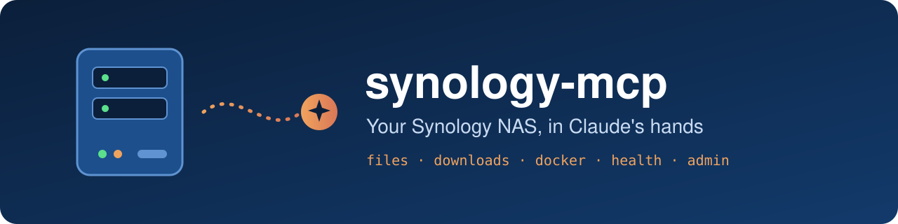

**English** · [Español](README.es.md)

<p align="center">
  
</p>

<p align="center">
  <a href="https://github.com/r03eRt/synology-mcp/actions/workflows/ci.yml"></a>
  <a href="https://github.com/r03eRt/synology-mcp/releases"></a>
  <a href="LICENSE"></a>
  
  
  
</p>

<p align="center">
  <b>Talk to your NAS.</b> Find files and photos, share from Drive, manage downloads and containers, keep an eye on your disks and administer DSM<br>
  from <b>Claude Code</b> or <b>Claude Desktop</b>, at home or away with QuickConnect. Secure by default.
</p>

<p align="center">
  <a href="#quick-install">Quick install</a> ·
  <a href="#6-tools">134 tools</a> ·
  <a href="#5-security">Security</a> ·
  <a href="#7-example-requests">Examples</a> ·
  <a href="docs/en/README.md">Documentation</a>
</p>

---

## What it looks like

> **You:** How's the NAS doing?
>
> **Claude:** Everything is working, but there are three things worth a look:
> - 🌡️ **41 °C**, up for 23 days. The volume is **89 %** full.
> - 💽 Disk 1 has 8 reallocated sectors, **stable** over the last 12 checks; both disks have been running for almost 7 years.
> - 🔒 There's a DSM **security update** and two packages with a new version.
>
> **You:** Free up some space.
>
> **Claude:** There's **6.7 GB** in recycle bins (almost all in Descargas) and Docker images no container uses, such as the previous Immich version (1.6 GB). Shall I empty the Descargas recycle bin and delete those images?

Every answer comes from this server's tools running against your real NAS. Actions that delete or change something **always ask for confirmation**.

## What it can do

| | Area | Most useful |
|---|---|---|
| 📁 | **Files** | Search by name, type, size or date · read documents and images · upload and download · move, compress · share with a link |
| 🖼️ | **Synology Photos** | Albums · places · find photos by date, place or text, each with its path to open it · upload into an album · normal and self-filling albums · share albums by link |
| ☁️ | **Synology Drive** | Recent, starred, labels, shared · share with people, links with password and expiry, file requests · convert to Synology Office |
| ⬇️ | **Downloads** | Search torrents · URLs, magnets and `.torrent` · pick files · RSS · speed limits and schedule · detect dead downloads |
| 🐳 | **Docker** | Container status, CPU/RAM and logs · start, stop and restart · create, edit and delete containers · pull and clean up images |
| 🩺 | **Health** | SMART for each disk · pending updates · broken or stopped packages (and start or stop them) · notifications and logs · volumes |
| 🧹 | **Space** | Recycle bins, unused images and the largest folders |
| 🛠️ | **Administration** | Users and groups, shared folders, permissions, app privileges and quotas, scheduled tasks · insecure services (SMB1, FTP…) and turning them off · firewall, auto block and blocking IPs · restart or shut down |
| 📹 | **Surveillance Station** | Cameras and their status, recordings, Home Mode |
| 💾 | **Hyper Backup** | Backup tasks, whether the last one failed and when the next one runs · start a backup now |
| 🌍 | **Anywhere** | QuickConnect (local network, direct or Synology relay) · multiple NAS |

## Quick install

```bash
claude plugin marketplace add r03eRt/synology-mcp
claude plugin install synology@synology-mcp
```

Then, in Claude Code: `/plugin configure synology@synology-mcp`. Enter the NAS address (`http://192.168.1.10:5000` or `quickconnect:<your ID>`), the user and the password, and ask it whatever you want.

Using Claude Desktop? Download the `.mcpb` from [Releases](https://github.com/r03eRt/synology-mcp/releases) and open it. More options in [Install](#3-install).

> Independent project, not affiliated with Synology Inc. AGPL-3.0 License. Tested on a DS218+ with DSM 7.4.1.

## Contents

1. [Requirements](#1-requirements)
2. [Set up a DSM user](#2-set-up-a-dsm-user)
3. [Install](#3-install)
4. [Configuration](#4-configuration)
5. [Security](#5-security)
6. [Tools](#6-tools)
7. [Example requests](#7-example-requests)
8. [Troubleshooting](#8-troubleshooting)
9. [Updating](#9-updating)
10. [Development](#10-development)
11. [Limitations and next steps](#11-limitations-and-next-steps)

## 1. Requirements

- A Synology NAS with **DSM 7** (7.2 or later recommended), reachable from the computer where Claude runs:
  - by its IP or name, on the same network, over VPN or through an open port;
  - or via **QuickConnect** (`quickconnect:<your ID>`), which works from anywhere without opening ports.
- **Node.js 22.19 or later** on that computer, for Claude Code or the manual install. Claude Desktop ships its own Node.
- For each area, its package installed on the NAS: Synology Drive Server, Synology Photos, Download Station, Container Manager, Surveillance Station or Hyper Backup. Tools for a package that isn't installed answer "is … installed?". `get_system_info` tells you which packages are present.

## 2. Set up a DSM user

Claude can only do what the DSM user you configure is allowed to do; that is the main security barrier.

**Recommended: a dedicated user without administrator rights.**

1. In *Control Panel → User & Group*, create a user, for example `claude`.
2. Under *Permissions*, give it read (or read/write) access **only** to the shared folders you want Claude to see.
3. Under *Applications*, allow File Station and, if you use them, Synology Drive, Synology Photos and Download Station.

What works with each kind of account:

| With a regular user | Only with an administrator |
|---|---|
| Files, Drive (including sharing and file requests), Photos (the folders the user can see), Download Station (its own downloads and torrent search), `get_system_info` | Docker, NAS health (`get_system_utilization`, `get_storage_status`, `get_disk_health`, `check_updates`, `get_notifications`, `get_system_logs`), packages (`get_packages`, `package_control`), Hyper Backup, recycle bins, Download Station speed limits and schedule, every user's downloads and administration (`dsm_*`: users, groups, shared folders, services, restart and shutdown) |

Using an administrator gives Claude access to the whole NAS. If you do, consider keeping read-only mode on.

**If your account has 2-step verification (2FA)**, register Claude once as a trusted device. It will ask for the authenticator code:

```bash
SYNOLOGY_URL=http://192.168.1.10:5000 SYNOLOGY_USERNAME=claude SYNOLOGY_PASSWORD='…' npx synology-mcp register-device
```

It prints `SYNOLOGY_DEVICE_ID=…`: put it in the configuration (field "2FA device token"). The device shows up in DSM (*Personal → Security*) and can be revoked there.

## 3. Install

### Claude Code: plugin (recommended)

```bash
claude plugin marketplace add r03eRt/synology-mcp
```

```bash
claude plugin install synology@synology-mcp
```

Then, inside Claude Code, fill in the details with `/plugin configure synology@synology-mcp`. The password is stored in the system credential store. The form also has optional fields for a **second NAS** (see [Multiple NAS](#multiple-nas)). The plugin includes:

- the server already bundled, with no dependencies to install;
- the `synology-nas` skill, which teaches Claude to use the NAS well: paths, which tool to use for what, confirming before deleting or stopping services, and how to read disk health.

### Claude Desktop: extension

Download `synology-mcp-<version>.mcpb` from [Releases](https://github.com/r03eRt/synology-mcp/releases) and double-click it. Claude Desktop asks for the same details and stores the password in the keychain.

### Manual install (any MCP client)

> The npm package is **not published yet**: `npx synology-mcp` won't work until then. In the meantime, use the source.

```bash
git clone https://github.com/r03eRt/synology-mcp.git
```

```bash
cd synology-mcp && npm install && npm run build
```

MCP client configuration:

```json
{
  "mcpServers": {
    "synology": {
      "command": "node",
      "args": ["/path/to/synology-mcp/dist/index.js"],
      "env": {
        "SYNOLOGY_URL": "http://192.168.1.10:5000",
        "SYNOLOGY_USERNAME": "claude",
        "SYNOLOGY_PASSWORD": "…"
      }
    }
  }
}
```

To keep the password out of the client configuration, store it in a `.env` file with `600` permissions and start with `node --env-file=/path/to/.env /path/to/synology-mcp/dist/index.js`. In Claude Code:

```bash
claude mcp add synology -s user -- node --env-file=/path/to/.env /path/to/synology-mcp/dist/index.js
```

## 4. Configuration

| Variable | Plugin / extension field | Default | Purpose |
|---|---|---|---|
| `SYNOLOGY_URL` | NAS URL | — | DSM address with port (`http://IP:5000`, `https://nombre:5001`) or `quickconnect:<ID>` |
| `SYNOLOGY_USERNAME` | DSM user | — | DSM user |
| `SYNOLOGY_PASSWORD` | DSM password | — | Password |
| `SYNOLOGY_READ_ONLY` | Read-only | `true` | `false` enables the 68 write tools (create, move, delete, download, share, create containers, change permissions or services, restart the NAS…) |
| `SYNOLOGY_INSECURE_TLS` | Accept an invalid HTTPS certificate | `false` | Accepts a self-signed, expired or wrong-name HTTPS certificate. Only on a trusted network |
| `SYNOLOGY_DEVICE_ID` | 2FA device token | — | Token from `register-device`, for accounts with 2FA |
| `SYNOLOGY_DEVICE_NAME` | — | `synology-mcp` | Name the device was registered under |
| `SYNOLOGY_TASK_TIMEOUT_MS` | — | `60000` | How long a tool waits for a long operation (copy, delete, search…) before returning its `taskid` to check later |
| `SYNOLOGY_NAS_FILE` | NAS list file | — | JSON file with **multiple NAS** (see below). Replaces the first three variables |
| `SYNOLOGY_NAS_NAME`, `SYNOLOGY_NAS2_*` | Name of this NAS, Second NAS: … | — | A second NAS without a JSON file: `SYNOLOGY_NAS2_URL`, `_USERNAME`, `_PASSWORD`, `_NAME`, `_DEVICE_ID`, `_INSECURE_TLS` |

### Using it away from home: QuickConnect

Set `SYNOLOGY_URL=quickconnect:<ID>`, with the ID shown in DSM under *Control Panel → External Access → QuickConnect*, which must be enabled. When connecting, the MCP asks Synology's service where the NAS is and tries, in this order:

1. **Local network**: a `…direct.quickconnect.to` name pointing to the NAS's local IP.
2. **Direct connection over the Internet**, only if the NAS is reachable from outside.
3. **Synology's relay**: works from anywhere without opening ports, though it's slower.

It uses the first one that answers. All three have a valid certificate, so `SYNOLOGY_INSECURE_TLS` isn't needed. If the connection drops (for example, when you leave home), it looks for the best route again on the next call. The ID is sent to Synology's service, just as Synology's own apps do.

### Multiple NAS

With `SYNOLOGY_NAS_FILE=/path/to/nas.json` (permissions `600`):

```json
{
  "default": "casa",
  "nas": [
    { "name": "casa", "url": "http://192.168.1.2:5000", "username": "claude", "password_env": "NAS_CASA_PASSWORD" },
    { "name": "padres", "url": "quickconnect:nas-padres", "username": "claude", "password_env": "NAS_PADRES_PASSWORD" }
  ]
}
```

- **Password**: `password_env` is the name of an environment variable that holds it, so it isn't stored in the file. `password` directly is also accepted.
- **Other optional per-NAS fields**: `device_id` / `device_id_env` (2FA), `device_name` and `insecure_tls`.
- **Global**: `SYNOLOGY_READ_ONLY` and `SYNOLOGY_TASK_TIMEOUT_MS` apply to all of them.
- **Tools**: `list_nas` (which NAS exist, which is active and how each one is reached) and `use_nas` (switch NAS) appear; the rest act on the active one. Ask Claude "switch to my parents' NAS".
- **2FA**: `register-device --nas <nombre>` registers the device on a specific one.
- **In the plugin or the extension**: their form has a **second NAS** (name, URL, user, password, 2FA token), and a field for the path of this JSON file for three or more. Outside them, the same second NAS can be set with `SYNOLOGY_NAS2_URL`, `_USERNAME`, `_PASSWORD`, `_NAME`, `_DEVICE_ID` and `_INSECURE_TLS`, plus `SYNOLOGY_NAS_NAME` for the first one.

Details, and how it's registered on the author's machine, in [docs/en/configuracion.md](docs/en/configuracion.md).

## 5. Security

- **DSM permissions**: the MCP can never do more than the configured user.
- **Read-only by default**: without `SYNOLOGY_READ_ONLY=false`, write tools don't exist for Claude.
- **Confirmation before destroying.** These tools are marked as destructive, and the skill requires Claude to say what it's about to do and wait for your "yes":
  - deleting or overwriting files: `delete`, `copy_move`, `upload_file`, `write_text_file`, `extract`;
  - emptying recycle bins: `empty_recycle_bin`;
  - removing downloads or feeds: `downloads_delete`, `downloads_rss_delete`;
  - Docker: `docker_stop`, `docker_restart`, `docker_remove_images`, `docker_update_container`, `docker_delete_container`;
  - administration: `dsm_run_task` (runs a script), `dsm_set_share_access` (changes who sees what), `dsm_update_user`, `dsm_delete_user` (also deletes the home folder), `dsm_delete_group`, `dsm_delete_shared_folder` (deletes everything in it), `dsm_set_services` and `dsm_power` (restart or shut down);
  - Photos: `photos_delete_album`, `photos_share_album` (public link), `photos_edit_person` (merging can't be undone);
  - Drive: `drive_share`, `drive_link`, `drive_delete_file_request`, `drive_delete_label`;
  - others: `delete_sharing_links`.
- **Safeguards against locking yourself out or going too far**:
  - it won't disable, demote or delete the account it signs in with, nor delete `admin`, `guest`, the built-in groups or system shared folders like `homes`;
  - it won't delete a shared folder that still has files unless told explicitly, or turn on the HTTPS redirect while it connects over HTTP;
  - restarting or shutting down needs the word repeated (`confirm: "reboot"`), and DSM's running tasks are listed first;
  - changing a container's variables, ports or folders means recreating it, and it asks for that explicitly (`recreate: true`);
  - it won't block private or local IP addresses, or deny applications to the account it signs in with.
- **Secrets it never returns**, even if the NAS API provides them:
  - the **values** of container environment variables (database passwords, API keys); it only gives their names;
  - tracker **private keys (passkeys)** in torrent, RSS and magnet URLs, and credentials inside URLs; they come out as `<redacted>`;
  - passwords and keys inside **scheduled task scripts** (only a summary of the command is shown, with values hidden);
  - users' **emails**;
  - the **serial numbers** of the NAS and its disks;
  - passwords you give it (new users, protected links, file requests). A password it generates is shown **once**.
- **Credentials**: with the plugin or the extension, in the system's secure store. In the manual install, preferably in a `.env` with `600` permissions. The repository history contains no personal data.

## 6. Tools

134 tools, 61 of them read-only. **L** = read, **E** = write (only with `SYNOLOGY_READ_ONLY=false`), **D** = destructive (asks for confirmation).

| Area | Tools | Main things |
|---|---|---|
| Files (File Station) | 22 (12 L) | list, search, read text and images, upload and download, copy, move, delete, compress, public links |
| NAS status and health | 9 (8 L) | system, CPU and RAM, storage, SMART, updates, notifications, logs, packages |
| Freeing up space | 2 (1 L) | recycle bins: how much they take and emptying them |
| Synology Drive | 22 (12 L) | recent, starred, labels, search, sharing with people, links, file requests, convert to Office |
| Synology Photos | 10 (3 L) | albums, places and people, search by date, place or text (with each photo's path), upload, self-filling albums, sharing |
| Download Station | 17 (6 L) | downloads, torrents (pick files), RSS, search, speed limits and schedule, dead downloads |
| Docker (Container Manager) | 18 (6 L) | status and logs, start and stop, create, edit and delete containers, CPU and memory limits, images, networks, Compose projects (create, start, stop, edit and delete) |
| DSM administration | 29 (10 L) | users, groups, folders and permissions, app privileges, quotas, encrypted folders, scheduled tasks, services, network and firewall (read), blocking IPs, restart and shutdown |
| Surveillance Station | 3 (2 L) | cameras and their status, recordings, Home Mode |
| Hyper Backup | 2 (1 L) | backup tasks, last result and next run, start or cancel a backup |
| Multiple NAS | 2 (2 L) | which NAS there are and switching between them (only with more than one) |

**Paths**: file paths start with a shared folder (`/photo/2024/foto.jpg`, `/home/Documentos`); `/home` is the user's personal folder. Synology Drive uses `/mydrive/…` (the same folder as `/home/Drive`), `/team-folders/<nombre>/…` or `id:<file_id>`.

The full list, tool by tool, is in the **[catalog](docs/en/catalogo.md)**. The parameters and the DSM API each one uses, in the [technical reference](docs/en/herramientas.md).

## 7. Example requests

**Status**
- "How's the NAS doing? Any disk with problems?"
- "Are there pending updates? What errors have there been this week?"
- "Who has logged into the NAS today?"
- "Is any package broken or stopped? Do I have backups?"

**Space**
- "The volume is almost full: what can I delete?"
- "How much space do the recycle bins take? Empty the Descargas one."
- "Delete the Docker images that aren't in use."

**Files**
- "Find the 2024 invoice PDFs in /home and tell me how much space they take."
- "Read /home/notas/lista.txt and summarize it."
- "Create a share link for /photo/Viaje that expires on Sunday."
- "Share the Proyecto Drive folder with marta as an editor."
- "Create a link so my family can upload the wedding photos to Drive."

**Downloads**
- "Add this magnet in /home/Descargas."
- "From the series torrent, download only episodes 1 to 3."
- "Which downloads are dead? Remove them."
- "Subscribe to this RSS feed and tell me what's new."
- "Search for the Ubuntu 24.04 ISO torrent and add the one with the most seeds."
- "Only download at night on weekdays, and cap uploads at 200 KB/s."

**Administration**
- "Who can see the photo folder?"
- "Is any insecure service enabled?"
- "Which scheduled tasks failed last time?"
- "Remove marta's access to Documents."
- "Create a user for Lucía with read-only access to photo."
- "Turn off SMB1 and Telnet."
- "Create a shared folder Proyectos that only the family group can use."
- "Which IPs are blocked? Block 203.0.113.7 for a week."
- "Which apps can marta use? Take away FTP."

**Photos**
- "Show me the photos from Scotland in July 2025."
- "Make an album with the best ones from Madrid."
- "Open the latest photo Marta uploaded."
- "Upload these photos to the Scotland album."

**Cameras**
- "Are the cameras working? Is anything recording?"
- "Turn on Home Mode."

**Docker**
- "Which containers are stopped? Show me pihole's latest errors."
- "Restart jellyfin."
- "Create an nginx container that serves /docker/web on port 8080."

**Drive**
- "List what I've starred in Drive."
- "Label the PDFs in /mydrive/2024 as "Taxes"."

## 8. Troubleshooting

| Message | What's happening | What to do |
|---|---|---|
| `Missing required environment variables` | The URL, user or password is missing | Check the configuration (section 4) |
| `Cannot reach the NAS at …` | No connection to that address | Check the IP, the port (5000 http, 5001 https) and that you're on the NAS's network. Away from home, use `quickconnect:<ID>` |
| `QuickConnect ID "…" was not found` | The ID doesn't exist | Copy it from *Control Panel → External Access → QuickConnect* |
| `none of its … addresses answered` | QuickConnect is disabled or the NAS is off | Enable it in DSM and check the NAS has a connection |
| `TLS error … (CERT_HAS_EXPIRED)` or similar | HTTPS certificate expired, self-signed or for another name | Renew it in *Control Panel → Security → Certificate*, use the certificate's name or set `SYNOLOGY_INSECURE_TLS=true` |
| `No such account or incorrect password (code 400)` | Wrong credentials | Repeating it many times blocks the IP (code 407) |
| `2-step verification code required (code 403)` | The account has 2FA | Run `register-device` (section 2) |
| `needs a DSM administrator account (code 105)` | The tool is admin-only | Use an account in the *administrators* group or do without it |
| `… not be allowed to use <package> (code 105)` | The user doesn't have permission for that application | Grant it in *Control Panel → Application Privileges* |
| `is <package> installed …? (code 102)` | That package isn't installed | Install it from Package Center |
| Write tools are missing | It's in read-only mode | `SYNOLOGY_READ_ONLY=false` |
| `finished: false` with a `taskid` | The operation is still running | Ask Claude to check it later (`get_task_status`) |
| `File requests are disabled in Synology Drive (code 1076)` | The Drive administrator has file requests off | Turn them on in *Synology Drive Admin Console → Settings* |
| `Public links are probably not allowed` (code 1040) | Drive doesn't allow public sharing | Enable it in *Synology Drive Admin Console → Settings → Sharing permissions*, or use `access: internal` |
| A container's variables or ports "didn't change" | DSM only changes the name and restart policy of an existing container | Ask again allowing it to recreate the container (`recreate: true`) |

## 9. Updating

- Plugin: `claude plugin marketplace update synology-mcp`, then `claude plugin update synology@synology-mcp`, and restart Claude Code.
- Claude Desktop: install the `.mcpb` from the latest [release](https://github.com/r03eRt/synology-mcp/releases).
- Manual: `git pull && npm install && npm run build`, and restart the client.

Each version's changes are in the [CHANGELOG](CHANGELOG.en.md).

## 10. Development

```bash
npm install
npm run typecheck    # types for src/ and test/
npm run build        # dist/ (npm package)
npm run bundle       # plugin/server/synology-mcp.cjs: the server in a single file, for the plugin and the extension
npm run pack:mcpb    # build/synology-mcp-<version>.mcpb
npm test             # regenerates the bundle and runs the tests against a simulated NAS, no network
SYNOLOGY_ENV_FILE=.env.admin npm run test:real   # optional: against a real NAS (reads, plus temporary items it deletes)
# extra, opt-in: SYNOLOGY_REAL_ADMIN_WRITES=1 (temporary user, group, shared folder), SYNOLOGY_REAL_DOCKER=1 (hello-world), SYNOLOGY_REAL_SEARCH=1 (torrent search)
```

Code layout and how a call flows: [architecture](docs/en/arquitectura.md).

Technical documentation in [docs/](docs/en/README.md):

- [tool catalog](docs/en/catalogo.md): every tool, by area;
- [tools](docs/en/herramientas.md): full technical reference;
- [Synology API](docs/en/api-synology.md): undocumented behaviors discovered while testing;
- [authentication](docs/en/autenticacion.md);
- [architecture](docs/en/arquitectura.md);
- [testing](docs/en/pruebas.md);
- [distribution](docs/en/distribucion.md);
- [roadmap](docs/en/hoja-de-ruta.md).

To add something: find the call in the DSM web UI (the NAS serves its JavaScript), try it by hand, write the tool with its test in `test/mock/`, document it and bump the version in `package.json`, `src/server.ts`, `plugin/.claude-plugin/plugin.json` and `mcpb/manifest.json` (a test checks that they match).

## 11. Limitations and next steps

- **npm**: the package isn't published yet.
- **Not tested in practice**: 2FA and the installed Claude Desktop extension. Also, on purpose, only tested with the simulated NAS: changing services (`dsm_set_services`), restarting or shutting down (`dsm_power`), editing people in Photos and encrypted folders (the test NAS has none) and recordings (its only camera is offline). Drive public links and file requests are disabled on the test NAS, so they are only tested with the simulated one.
- **Hyper Backup**: running and cancelling a backup are only tested with the mock NAS (the test NAS has no tasks yet); creating tasks is not included.
- **Not included**: changing the firewall or network settings (read only: a mistake would lock you out), fully encrypting or decrypting folders (only mounting), camera snapshots and live video. See the [roadmap](docs/en/hoja-de-ruta.md).

## 12. License

[GNU AGPL-3.0](LICENSE) since 0.17.0 (MIT up to 0.16.0). It is free software: you can use, study, modify and share it. If you distribute a modified version, or offer it as a service over a network, you must publish its complete source under the same license. Using it in a closed-source product needs a separate license: contact the author.

© 2026 Roberto Morgado Luengo.
